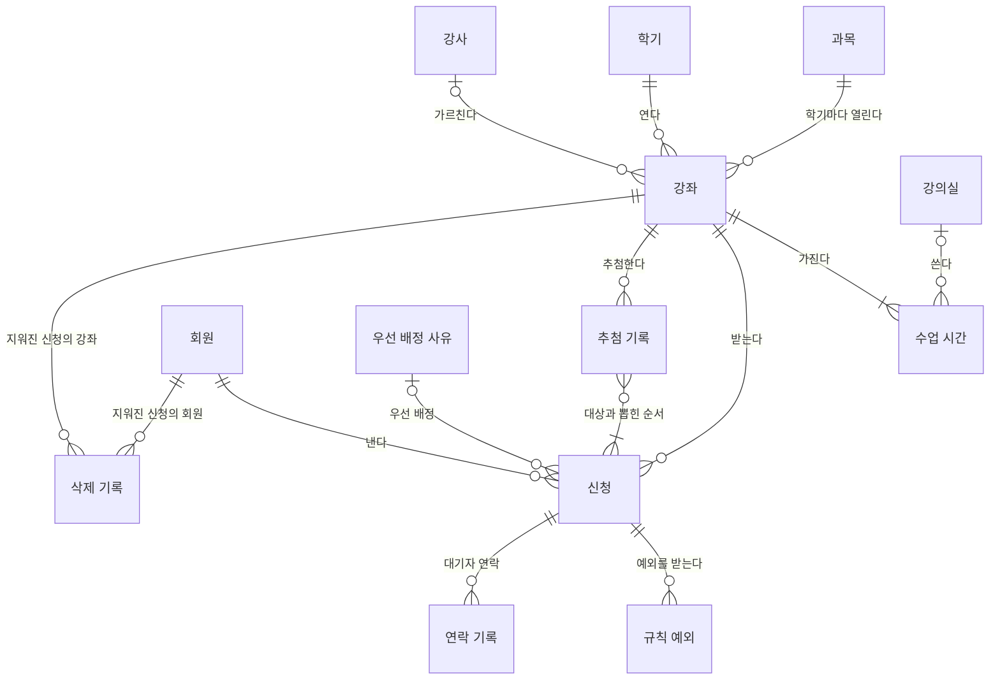
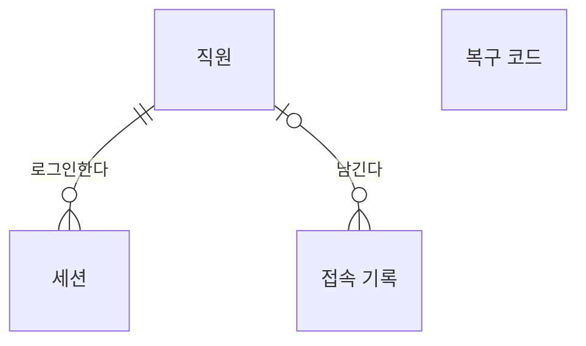

# 개념 ERD

배움마루가 다루는 대상과 그 관계를 보여주는 그림이다. 용어는 [용어집](GLOSSARY.md), 규칙은 [업무 규칙](BUSINESS_RULES.md)을 따른다.

- **개념** 수준의 그림이다. 실제 테이블, 컬럼, 자료형은 4단계(아키텍처 결정) 이후에 정한다.
- 각 대상이 무엇을 담는지는 [대상별 정보](#대상별-정보)에 적었다.

## 그림

선 끝 기호는 이렇게 읽는다.

| 기호 | 뜻 |
|---|---|
| `\|\|` | 정확히 하나 |
| `\|o` | 없거나 하나 |
| `\|{` | 하나 이상 |
| `o{` | 없거나 여러 개 |

예: `Subject ||--o{ Course`는 "강좌 하나는 과목 정확히 하나에 속하고, 과목 하나에는 강좌가 없거나 여러 개 있다"는 뜻이다.

## 세 묶음으로 보기

1. **강좌 쪽 (학기마다 새로 만드는 것과 이어지는 것)**
   - 학기마다 새로 만든다: 학기, 강좌, 수업 시간
   - 학기가 바뀌어도 이어진다: 과목, 강사, 강의실 (기초 정보)
   - 그래서 새 학기를 만들 때 지난 학기 강좌를 복사해 시작할 수 있다.
2. **신청 쪽**
   - 회원과 강좌를 잇는 것이 신청이다. 신청 한 건 = 회원 한 명 × 강좌 하나.
   - 상태, 대기 순번, 우선 배정 여부는 신청에 붙는다.
3. **기록 쪽 (나중에 "왜 이렇게 됐는지" 설명하기 위한 것)**
   - 추첨 기록, 규칙 예외, 연락 기록, 삭제 기록
   - 이 기록들은 고치거나 지우지 않고 쌓기만 한다.

## 대상별 정보

| 대상 | 담는 정보 | 관련 규칙 |
|---|---|---|
| 학기 | 이름(예: 2027년 1학기), 기간, **신청 규칙 설정**(시간 겹침·같은 과목 중복 켜기/끄기, 최대 신청 개수, 대기 인원 상한, 확정 단계 켜기/끄기, 기본 선발 방식). 새 학기는 지난 학기 설정을 복사해서 시작한다 | BR-T1, BR-T2, BR-T5, BR-A1~A3, BR-S1, BR-S9, BR-C1 |
| 과목 | 이름, 분류(선택, 글자. 과목을 묶어 보여 주기만 한다) | BR-J1, BR-J2, BR-A2 |
| 강좌 | 학기, 과목, 수준(선택, 글자), 반(선택, 글자), 정원, 선발 방식(학기 기본값과 다를 때), 강사, **선발 마감 여부** | BR-T3, BR-T6, BR-S1, BR-L3~L5 |
| 수업 시간 | 요일, 시작 시각, 종료 시각, 강의실(선택). 강좌 하나에 하나 이상. 요일마다 장소가 다른 강좌가 있어 강의실은 강좌가 아니라 이 줄에 붙는다 | BR-T4, BR-A1 |
| 강사 | 이름, 연락처(선택) | — |
| 강의실 | 이름, 건물(기본값 본관), 층(선택) | BR-R1, BR-R2 |
| 회원 | 회원번호, 이름, 연락처, 성별, 생년월일 | BR-M1~M5 |
| 신청 | 회원, 강좌, 접수 시각, 접수한 직원, 상태, 대기 순번, 우선 배정 사유(선택), 추가 신청 여부 | BR-A4, BR-S2~S9, BR-W1~W6, BR-X1~X3 |
| 우선 배정 사유 | 이름(예: 반장). 학기마다 다시 만들지 않는 목록 | BR-S3 |
| 규칙 예외 | 신청, 어긴 규칙, 사유, 시각, 처리한 직원. 신청 하나가 규칙 여러 개를 어기면 여러 건 | BR-A6 |
| 연락 기록 | 신청, 시각, 결과(수락/거절/연락 안 됨), 연락한 직원 | BR-W2 |
| 추첨 기록 | 강좌, 실행 시각, 실행한 직원, 난수 시드, 추첨 방식 버전, 취소 여부, 대상 신청들과 각각 뽑힌 순서 | BR-L1~L5 |
| 삭제 기록 | 회원, 강좌, 삭제 시각, 삭제한 직원, 사유(선택). 신청은 지워졌으므로 신청이 아니라 회원과 강좌를 가리킨다 | BR-D1~D3 |

## 그림에 없는 것

- **기관**: 배움마루 데이터 하나에 기관은 하나다. 모든 대상이 같은 기관에 속하므로 그림에서 뺐다.
- **직원, 기기, 접속 기록**: 로그인 방식이 [ADR 0003](../adr/0003-login-access.md)으로 정해졌다. 기록들의 "처리한 직원"은 직원 계정을 가리킨다. 이 대상들은 업무(수강 사무)가 아니라 접근 관리용이라 위 그림에는 넣지 않고 [접근 관리](#접근-관리)에 따로 그렸다.
- **수강 이력**: 따로 저장하지 않는다. 지난 학기의 확정(확정 단계를 끈 기관은 합격)된 신청에서 계산한다.
- **출석**: 첫 버전은 출석부를 출력만 하고, 출석 결과는 저장하지 않는다.

## 접근 관리

로그인에 쓰는 대상이다. 규칙은 [직원과 접근](BUSINESS_RULES.md#직원과-접근)을 따른다. 기기는 기기 승인을 만들 때 더한다.

| 대상 | 담는 정보 | 관련 규칙 |
|---|---|---|
| 직원 | 이름, PIN(해시), 역할, 유효기간(선택, 임시 직원은 필수), 사용 중지 여부, 연속으로 틀린 횟수, 잠금이 풀리는 시각 | BR-K2~K10 |
| 세션 | 직원, 증표(해시), 시작 시각, 마지막 요청 시각. 로그아웃하면 지운다 | BR-K1, BR-K8 |
| 접속 기록 | 시각, 직원(이름을 고르지 않은 실패면 없음), 무슨 일(로그인 성공·실패 등) | BR-K13 |
| 복구 코드 | 코드(해시), 만든 시각. 기관에 하나뿐이다 | BR-K11, BR-K12 |
