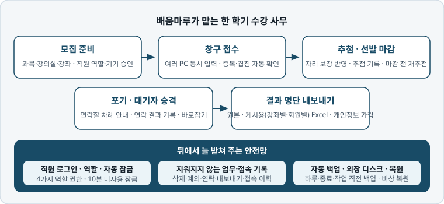

지난 글([배움마루 창세기](../why-baeum-maru/))에서는 제가 한 노인문화센터에서 근무하며 본 수강 신청 현장에서 이야기를 시작했습니다. 종이 신청서와 엑셀을 오가며 여섯 단계를 거치던 수고, 월 결제 유료 프로그램이 소규모 기관에 남기는 예산 부담, 그리고 어르신 개인정보 때문에 외부 서버 대신 기관 PC 안에 데이터를 두기로 한 이유까지 전했습니다.

왜 만들게 되었는지, 왜 이런 구조를 골랐는지는 정리한 셈입니다. 그렇다면 자연스럽게 다음 질문이 남습니다.

**"그래서 배움마루는 실제로 무슨 일을 하는 프로그램인가요?"**

기능 목록을 차례대로 늘어놓으면 설명서처럼 지루해집니다. 대신 소규모 기관의 **한 학기 수강 사무가 흘러가는 순서**를 따라가며, 제가 현장에서 어떤 장면을 떠올리고 어떤 걱정 때문에 이렇게 만들었는지 함께 풀어 보려 합니다.

## 1. 모집 준비: 귀찮은 엑셀 양식 복사와 수정

사회복무요원이었던 저는 직접 신청을 받는 일은 최대한 피해야 했지만, 하루 업무를 정리할 때는 엑셀 파일의 구성을 어깨너머로 보곤 했습니다. 9월 즈음 근무를 시작해 1년 9개월 동안 세 번의 수강 신청 보조를 거치면서, 학기마다 과목이 달라져 양식이 계속 바뀐다는 사실을 알게 되었습니다. 특히 기관에서 쓰던 양식은 과목을 새로 넣거나 빼기가 무척 까다로운 구조였습니다.

새 학기가 열릴 때마다 과목 이름, 강의실, 우선 배정 기준을 엑셀 양식에 매번 다시 옮겨 적는 일부터가 큰 피로였습니다. 그래서 학기가 바뀌어도 이어지는 과목, 강의실, 우선 배정 사유는 **기초 정보**에 한 번만 등록해 두고, 새 학기를 열 때 골라 쓰도록 만들었습니다.

## 2. 소중한 개인정보: 이를 위한 사람과 권한

모집 전에 꼭 신경 써야 했던 것은 사람과 계정의 권한이었습니다. 당시 엑셀에 회원 정보를 직접 입력하는 일은 담당 선생님이나 지원 나온 사회복지사 선생님만 맡으셨습니다. 사회복무요원이나 자원봉사자는 개인정보 접촉을 최대한 피해야 했기 때문입니다.

하지만 실무 현장은 너무 바빴습니다. 대기표 배부와 안내를 맡던 저는 하루에 400분의 어르신을 뵐 때도 많았고, 안쪽의 선생님들은 화장실도 제대로 다녀오지 못하실 정도였습니다. 그렇다고 잠시 자리를 비우며 노트북을 다른 사람에게 맡길 수도 없었습니다. 엑셀 파일은 열려 있는 순간 이미 읽기와 쓰기가 모두 가능한 최고 권한 상태라, 의도치 않게 개인정보가 노출되거나 실수로 지워질 위험이 컸습니다. 그 모습이 내내 마음에 남았습니다.

그래서 배움마루에서는 업무 절차마다 역할을 분명히 나누었습니다.

- **관리자**: 직원 관리, 접속 기록, 백업·복원, 기기 승인까지 모든 설정과 관리 권한
- **직원**: 회원, 강좌, 신청, 추첨, 대기자 승격, 원본 명단 내보내기까지 수강 사무 실무 전반
- **임시 직원**: 접수 기간에 회원 등록과 신청 접수·삭제만 돕는 제한된 권한 (회원 삭제나 추첨, 규칙 예외, 원본 명단 내보내기는 불가)
- **조회 전용**: 단순 안내나 확인 업무만 맡는 인원이 데이터를 고치지 않고 보기만 할 수 있는 권한

여기에 계정마다 **유효기간(마지막 날)**을 둘 수 있게 했고, 특히 임시 직원 계정은 유효기간을 반드시 지정하도록 했습니다. 누군가에게 접수 창구를 잠시 맡겨야 할 때도 필요한 최소 권한만 열어 두고, 기간이 끝나면 관리자가 깜빡 잊어도 자동으로 로그인이 막히게 하기 위해서입니다.

## 3. 여러 기기의 접속: 허락되지 않은 기기가 들어온다면?

접수처에 노트북을 한 대 더 놓을 때도 마음에 걸리는 점이 있었습니다. 제가 근무했던 곳은 강의실마다 공유기가 있었고, 이용자분들이 편하게 쓰실 수 있도록 벽면에 와이파이 QR코드와 아이디, 비밀번호가 적혀 있었습니다. 비밀번호도 비교적 단순한 편이었습니다. 당시 사회복무요원 신분으로 보안 문제를 따로 건의하기는 어려웠고, 엑셀만 쓰던 때라 큰 문제로 이어지지도 않았습니다.

하지만 배움마루처럼 같은 네트워크 안에서 여러 PC가 데이터를 주고받게 되면 이야기가 달라집니다. 이용자분들과 같은 와이파이를 쓰는 환경에서 아무 기기나 접속할 수 있다면 심각한 보안 문제가 됩니다.

그래서 다른 PC가 처음 연결할 때는 두 화면에 뜬 6자리 승인 번호를 관리자가 눈으로 맞대고 PIN으로 직접 허락하는 **기기 승인**을 거치도록 했습니다. 승인받기 전에는 로그인 화면의 직원 이름 목록조차 보이지 않아, 어떤 계정이 있는지조차 알 수 없습니다. (내부망 통신 암호화는 정식 출시 준비 단계에서 보강할 예정입니다.)

## 4. 접수 5일: 규칙과 현장 예외 사이의 고민

접수 첫날 줄이 길어지면 사람 눈으로 모든 규칙을 챙기기가 가장 어렵습니다. 배움마루에서는 한 번 등록한 회원 정보를 다음 학기에도 그대로 이어 쓰고, 이름이나 연락처 뒷자리, 회원번호로 회원을 바로 찾아 신청을 받습니다.

신청을 저장할 때는 프로그램이 먼저 **수업 시간 겹침**, **같은 과목 중복 신청**, **같은 강좌 중복 신청**을 확인해 막아 줍니다.

그런데 현장을 떠올려 보니 한 가지 딜레마가 있었습니다. *"규칙은 규칙이지만, 이번 한 번만 꼭 받아 드려야 하는 사정"*은 어느 기관에나 생깁니다. 프로그램이 너무 꽉 막혀 있으면 직원분들이 결국 다시 엑셀로 도망가게 됩니다. 그렇다고 아무 흔적 없이 통과시키면 나중에 민원이 들어왔을 때 설명할 길이 없습니다. 그래서 규칙을 어긴 신청도 꼭 필요할 때는 직원이 사유를 적고 **규칙 예외**로 저장할 수 있게 했고, 누가 언제 어떤 사유로 받아 주었는지 기록으로 남깁니다.

접수 기간에 회원이 마음을 바꾸거나 직원이 잘못 입력해 지운 신청도 마찬가지입니다. 그냥 흔적 없이 사라지면 나중에 "분명 신청했는데 왜 명단에 없냐"는 문의 앞에서 난감해집니다. 신청 목록에서는 깨끗이 빠지되, 누가 언제 지웠는지 **삭제 기록**은 남도록 두었습니다.

노트북 여러 대로 동시에 접수해도 쉬는 시간에 엑셀을 합칠 필요가 없습니다. 한 자리에서 회원을 등록하거나 신청을 받으면, 같은 네트워크에 연결된 다른 PC 화면의 목록과 신청 인원 수도 따로 새로고침하지 않아도 바로 바뀝니다.

## 5. 추첨 날: 화면 앞의 민감한 사유와 공정성

추첨은 센터에서 가장 민감한 순간입니다. 정원 이하인 강좌는 추첨 없이 **전원 당첨**으로 끝나지만, 정원을 넘은 강좌는 반장 같은 **자리 보장** 신청을 먼저 정원에 넣고 남은 자리를 무작위로 추첨합니다. 자리 보장 신청이 정원보다 많으면 추첨을 진행하지 않고 먼저 알려 줍니다.

추첨 화면을 설계하며 가장 조심했던 것은 **우선 배정 사유**였습니다. 만약 기관이 '장애인 우대' 같은 우선 배정 사유를 쓰고 있다면, 어르신들이 함께 지켜보는 추첨 화면에 그 사유 이름이 그대로 뜨는 것 자체가 민감한 개인정보 노출이 됩니다. 그래서 자리 보장은 정확히 반영하되, 추첨 화면에는 사유 이름을 띄우지 않도록 숨겼습니다.

또 추첨과 재추첨, 선발 마감은 **대표 PC(호스트 PC) 앞에서만** 할 수 있게 묶어 두었습니다. 추첨할 때마다 시각, 담당 직원, 대상 목록, 같은 결과를 다시 만들어 볼 수 있는 추첨 번호가 **추첨 기록**으로 남고, 마감 전에 다시 추첨하더라도 이전 기록을 몰래 지우지 않고 '취소됨' 상태로 남겨 둡니다. 나중에 누가 결과를 묻더라도 기록으로 답할 수 있어야 하기 때문입니다.

## 6. 발표 다음 날: 대기 순번이 밀리거나 실수가 난다면?

추첨 결과를 발표하면 곧바로 "개인 사정으로 못 듣겠다"는 포기 연락이 들어옵니다. 예전에는 이때부터 엑셀 줄을 지웠다 고쳤다 하느라 가장 헷갈렸습니다.

여기서 제가 신경 쓴 것은 **대기 순번**입니다. 앞사람이 포기했다고 2번 대기자가 갑자기 1번으로 밀려 버리면, 이미 "대기 2번"이라고 안내받은 어르신과 직원 사이에 말이 엇갈리기 쉽습니다. 그래서 앞사람이 빠져도 원래 받은 대기 순번 번호는 바꾸지 않고, 당첨자가 포기해 **빈자리**가 생기면 지금 전화할 **연락할 차례**만 프로그램이 짚어 주도록 했습니다.

대기자에게 전화를 걸고 나면 **수락, 거절, 연락 안 됨** 중 하나를 남깁니다. 수락하면 빈자리가 있을 때 당첨으로 승격되고, 거절하면 포기로 바뀝니다. 전화를 받지 않은 분은 대기 순번을 유지한 채 다음 순번을 연락할 차례로 넘겨 두고, 나중에 다시 전화가 와서 수락하면 빈자리가 있을 때 받아 줄 수 있습니다.

바쁜 창구에서 다른 사람의 포기를 잘못 누르는 실수도 생각하지 않을 수 없었습니다. 회원의 번복을 받아 주는 버튼이 아니라 직원의 실수만 바로잡는 장치이기에, **관리자만 사유를 적고 포기 전 상태로 바로잡을 수 있게** 제한했습니다. 모든 포기, 연락 결과, 바로잡기는 고치거나 지울 수 없는 기록으로 남습니다.

## 7. 게시판과 홈페이지: 손으로 이름 가리기의 아찔한 실수

추첨 결과를 뽑고 나면 게시판과 홈페이지에 붙일 명단을 만들어야 합니다. 예전에는 직원이 엑셀에서 이름 가운데 글자를 일일이 `○`로 바꾸곤 했습니다. 그러다 한 줄만 놓쳐도 연락처나 생년월일이 그대로 게시판에 붙어 버립니다.

그래서 아예 작업용과 게시용을 나누어, 선발을 마감한 강좌 결과를 세 가지 **Excel 명단**으로 바로 내보낼 수 있게 했습니다.

- **원본 명단** (관리자·직원만): 직원이 다시 꾸며 쓸 수 있도록 강좌마다 당첨자와 대기자를 나란히 둔 표
- **게시용 강좌별 명단**: 회원이 보도록 강좌마다 당첨자와 대기자를 나란히 정리한 표
- **게시용 회원별 명단**: 회원 한 명이 한 줄에 자신의 당첨 강좌와 대기 강좌(순번)를 모아 보는 표

이름(`홍○동`), 회원번호(`12-○○○34`), 연락처(`010-○○○○-5678`), 생년월일(`1950년`)을 골라 가릴 수 있고, 가림 글자도 `○`, `*`, `X` 가운데 선택합니다. 특히 게시용 명단에서는 연락처나 생년월일을 넣더라도 **항상 가린 상태로만** 나가도록 잠가 두었습니다. 우선 배정 사유 이름이나 포기 사유처럼 민감할 수 있는 메모는 어느 명단에도 섞이지 않으며, 누가 언제 어떤 조건으로 명단을 내보냈는지도 기록에 남습니다.

## 8. 보이지 않는 안전망: 직원 기억력에만 맡길 수 없는 일들

아무리 조심해도 바쁜 창구에서는 잠깐 자리를 비울 때가 있고, 접수 기간에 갑자기 정전이 날 수도 있습니다. 직원분들이 매번 "화면 잠가야지", "백업 눌러야지" 하고 기억력에 기대어 버티게 두면 언젠가 사고가 납니다.

그래서 안전장치는 뒤에서 알아서 돌아가도록 만들었습니다. 로그인하지 않으면 어떤 데이터도 보이지 않고, PIN을 5번 연속 틀리면 계정이 5분간 잠기며, 10분 동안 쓰지 않으면 화면이 자동으로 잠깁니다. 로그인 성공·실패, 로그아웃, 복원 같은 **접속 기록**도 고치거나 지울 수 없이 쌓입니다.

데이터 파일 역시 하루 한 번, 앱을 끌 때, 추첨이나 선발 마감 직전, 복원 직전에 자동으로 백업됩니다. 관리자가 외장 디스크 같은 **두 번째 위치**를 지정해 두면 하루 한 번 백업이 그곳에도 한 부 더 복사됩니다. 정전으로 데이터 파일이 손상되어 로그인조차 못 하게 되더라도, 대표 PC 앞에서 가장 최근 정상 백업으로 되돌릴 수 있습니다.

---

지금까지 소개한 한 학기의 흐름은 모두 만들어 두었고, 정식 출시 전까지 다듬고 있습니다. 여기에 **선발 마감 뒤 추가 신청**, **당첨 뒤 수강 확정 단계**, **다른 PC로 호스트 넘기기** 같은 남은 기능과 출시 준비(내부망 통신 암호화, 서명 (제작자 확인용 디지털 서명) 등)를 차례대로 마무리할 예정입니다.
