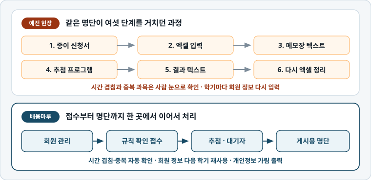
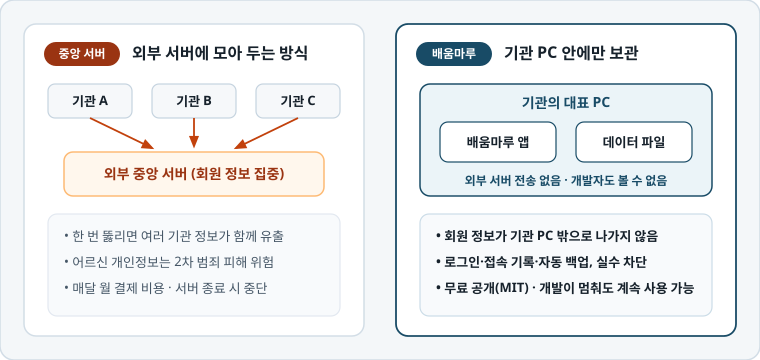
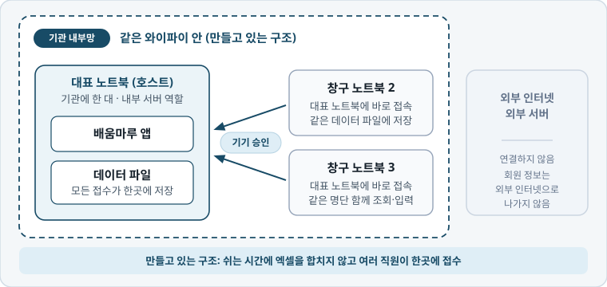

며칠씩 강의실 하나를 통째로 비워 접수처를 차리는 풍경을 보신 적이 있나요?

저는 한 노인문화센터에서 약 1년 9개월 동안 사회복무요원으로 근무했습니다. 새 학기 모집 기간이 되면 평일 닷새 내내 접수처가 열렸습니다. 저는 어르신들께 대기 순번표를 나눠 드리고 안내를 맡았습니다. 안쪽에서는 직원 두 분이 종이 신청서와 회원증을 보며 시간표가 겹치지 않는지, 같은 과목을 두 번 쓰지는 않았는지 눈으로 확인하고, 옆자리의 다른 두 분이 그 내용을 노트북 엑셀에 옮겨 적었습니다.

개인정보를 최대한 접하지 않아야 하는 사회복무요원인 저는 그 일을 도와드릴 수 없어 옆에서 지켜봐야만 했습니다. 시간이 겹치지는 않는지, 신청 가능한 강좌 수를 넘기지는 않았는지 일일이 점검하고, 두 대의 노트북에 나누어 입력했다가 쉬는 시간에 하나의 엑셀 파일로 합치시는 모습이 꽤나 힘들어 보이셨습니다.

그런데 진짜 힘든 일은 접수가 끝난 뒤에 시작되었습니다.

## 여섯 단계를 거치던 명단, 그리고 처음 만든 추첨기

당시 센터에서 추첨 결과를 뽑는 과정은 생각보다 훨씬 복잡했습니다.

종이 신청서를 엑셀에 옮기고, 추첨 프로그램에 넣기 위해 엑셀 내용을 메모장 텍스트로 다시 옮겼습니다. 추첨을 돌린 뒤에는 결과 텍스트를 꺼내서 또다시 엑셀 표로 옮겨 정리해야 했습니다. 같은 회원 정보를 학기마다 처음부터 다시 입력하는 일도 예사였습니다.

그 과정을 옆에서 보면서 "이건 프로그램이 꼭 필요하다"는 생각이 자연스럽게 들었습니다. 지금처럼 AI 코딩 도구가 실사용 수준으로 도와주던 때도 아니었습니다. 막 GPT-3.5가 나왔던 시절이었고, 저 역시 범용 소프트웨어를 제대로 만들어 본 적은 처음이었습니다.

당시 제 실력으로 닿을 수 있었던 최대치는 여기까지였습니다. **미리 정리해 둔 엑셀 파일을 읽어 들여 추첨을 하고, 결과를 다시 엑셀로 내보내는 작은 프로그램**이었습니다.

그 첫 추첨기를 만들 때 가장 중요하게 생각한 것은 **공정성**이었습니다. 오해를 일으킬 만하거나 과장된 연출은 최대한 빼고, 어르신들께서 결과를 자연스럽게 납득하실 수 있는 화면을 만드는 데 꽤 오랜 시간을 고민했습니다. 0.1초마다 당첨자와 대기자 후보가 화면에서 바뀌다가, 추첨을 멈추면 그 순간 바로 결과가 정해지도록 최대한 간단명료하게 만들었습니다. 다행히 처음 도입했을 때 어르신들이 차분히 납득하시는 모습을 보며 안심했던 기억이 납니다.

그 프로그램만으로도 옮겨 적는 수고는 제법 줄었습니다. 하지만 아쉬움이 더 크게 남았습니다. 추첨은 전체 수강 사무의 한 조각일 뿐이었습니다. 회원 등록, 시간 겹침 확인, 추첨, 대기자 연락, 게시용 명단 정리까지 하나로 이어지지 않으면 현장의 실수와 야근은 결국 반복되기 때문입니다.

얼마 전 그 첫 추첨기를 아직도 소중히 사용해 주시는 모습을 보았습니다. 그 장면을 보며, 지난 3년 동안 많이 성장한 제가 이번에는 제대로 된 범용 소프트웨어를 만들어 보고 싶다는 마음이 들었습니다.

## 첫 추첨기에서 배움마루로, 무엇이 달라졌나요?

3년 전 만든 첫 추첨기와 지금 만들고 있는 배움마루는 출발점은 같지만, 바라보는 범위가 다릅니다.

첫째, **추첨 한 조각에서 수강 사무 전체 흐름으로** 넓혔습니다. 예전 첫 추첨기는 직원분들이 엑셀을 다 정리해 둔 뒤에야 쓸 수 있었습니다. 배움마루는 회원 등록과 강좌 관리, 시간 겹침과 중복 과목을 자동으로 막아 주는 접수, 추첨과 우선 배정, 대기자 연락과 승격, 개인정보를 가린 게시용 명단 내보내기, 자동 백업과 복원까지 한곳에서 이어집니다.

둘째, **학기마다 새로 만들던 파일에서 이어지는 기록으로** 바꾸었습니다. 새 학기가 열릴 때마다 회원 정보를 처음부터 다시 입력할 필요가 없습니다. 누가 언제 신청을 지웠는지, 대기자에게 연락한 결과는 어땠는지도 지워지지 않는 기록으로 남아 나중에 확인할 수 있습니다.

셋째, **한 센터 전용 도구에서 여러 소규모 기관이 쓸 수 있는 프로그램으로** 설계했습니다. 기관마다 다른 과목과 강의실, 우선 배정 사유를 직접 만들어 쓸 수 있게 했고, 신청 규칙도 기관에 맞게 고를 수 있도록 준비하고 있습니다.

## 왜 월 결제 유료 프로그램이 아닌 무료 공개 프로그램인가요?

근무를 하면서 다른 노인문화센터나 복지관들은 어떻게 일하는지도 자연스럽게 찾아보게 되었습니다. 비슷한 고민을 안고 있는 곳이 많았습니다. 현장에 딱 맞는 전용 프로그램 없이, 추첨 기능만 따로 가져다 쓰거나 엑셀을 돌려 막으며 학기를 넘기는 모습도 보였습니다.

시중에 수강 관리 프로그램이 아예 없는 것은 아닙니다. 하지만 대부분 유료이고, 매달 요금을 내는 월 결제 방식이 많습니다.

소규모 기관에서 매달 빠져나가는 고정 지출은 생각보다 큰 벽입니다. 예산 자체가 넉넉하지 않은 데다, 매년 예산을 짜고 집행하는 과정에서 고정 사용료가 부담이나 지적의 대상이 되기도 합니다. "꼭 써야 하는데 예산 때문에 못 쓰는" 상황이 생기는 것입니다.

그래서 다시 만들기로 마음먹었을 때, 아예 방향을 분명히 잡았습니다. 추첨기 하나를 고쳐 쓰는 대신 **수강 사무 전산 전반을 처음부터 제대로 다시 만들되, 비용 걱정은 완전히 없애자**고 결심했습니다. 재능기부하는 마음으로 누구나 무료로 쓰고 필요하면 고쳐 쓸 수 있는 공개 프로그램(MIT 라이선스)으로 열기로 한 이유입니다.

## 왜 클라우드 대신 기관 PC 안에만 저장하나요?

요즘 프로그램을 만든다고 하면 누구나 웹 사이트와 중앙 서버(클라우드)를 먼저 떠올립니다. 솔직히 말씀드리면, 저 역시 서버를 하나 띄워 웹으로 만드는 편이 개발하고 관리하기는 훨씬 편합니다.

그럼에도 배움마루는 **회원 데이터를 외부 서버에 보내지 않고, 기관 PC 안에만 보관하는 방식**을 골랐습니다. 이유는 세 가지입니다.

첫째, **개인정보가 한곳에 모이는 위험** 때문입니다. 중앙 서버에 여러 기관의 회원 명단이 쌓여 있다고 가정해 보겠습니다. 요즘은 AI 도구로 보안 취약점을 찾는 일도 예전보다 훨씬 쉬워졌습니다. 개인 개발자가 운영하는 서버가 한 번 뚫리면 그 책임과 피해는 감당할 수 없는 수준이 됩니다.

둘째, **개인정보의 주인이 주로 어르신이라는 점**입니다. 노인문화센터와 복지관의 회원 정보에는 이름, 연락처, 생년월일, 어느 센터를 다니는지 같은 민감한 생활 정보가 담깁니다. 이런 정보가 외부로 새어 나가면 보이스피싱 같은 2차 범죄 피해로 곧장 이어질 수 있습니다. 개발자인 저조차 기관의 회원 데이터를 들여다볼 수 없는 구조가 가장 안전하다고 판단했습니다. 물론 꼭 어르신의 개인정보만 소중한 것은 아닙니다. 다만 개인정보가 유출되었을 때 또 다른 범죄 피해로 이어지기 쉬운 분들이 어르신이나 어린이라고 생각했습니다.

셋째, **현장의 접수 방식**입니다. 어르신 이용자가 많은 기관에서는 온라인 신청보다 직원이 창구에서 직접 이야기를 들으며 받는 방문 접수가 중심입니다. 그리고 이미 많은 기관이 회원 명단을 센터 PC 안의 엑셀 파일로 보관하고 있습니다. 굳이 위험을 감수하며 외부 서버로 옮길 필요 없이, **지금처럼 센터 PC 안에 데이터를 두되, 엑셀과 달리 직원 로그인과 접속 기록이 있고, 자동으로 백업하며, 실수를 막아 주는 전용 프로그램**을 쓰는 편이 현장과 가장 잘 맞았습니다.

제가 언젠가 이 프로젝트에서 손을 떼거나 서버 비용을 감당하지 못하게 되더라도, 기관 PC에 깔려 있는 배움마루는 멈추지 않고 계속 돌아갑니다.

## 외부 서버가 없는데, 노트북 두 대로 어떻게 함께 접수하나요?

여기서 자연스럽게 떠오르는 질문이 하나 있습니다. "외부 서버를 안 쓰고 PC 안에만 저장한다면, 결국 컴퓨터 한 대에서만 신청을 받아야 하는 것 아닌가요?"

앞에서 말씀드렸듯, 접수 기간에는 직원 두 분이 노트북 두 대에 나누어 입력하고 쉬는 시간에 하나의 엑셀 파일로 합치는 일이 큰 수고였습니다. 외부 서버를 없애면서 이 불편까지 그대로 남기면 안 됩니다.

그래서 배움마루는 **기관 안의 같은 와이파이(내부망)를 쓰는 방식**으로 구조를 잡았습니다. 접수처에 놓인 노트북 가운데 **한 대가 데이터를 보관하는 대표 PC(호스트)이자 내부 서버 역할**을 맡고, 옆자리의 다른 노트북들은 외부 인터넷이 아니라 그 대표 노트북에 바로 접속해 같은 데이터를 함께 씁니다.

이렇게 하면 두 가지가 한꺼번에 해결됩니다. 모든 접수가 처음부터 대표 노트북의 데이터 파일 한곳에 모이므로 **쉬는 시간에 엑셀 파일을 취합할 필요가 없습니다.** 동시에 통신이 기관 내부망 안에서만 이루어지므로 회원 정보가 외부 인터넷으로 나가지도 않습니다. 새 노트북이 처음 연결될 때는 대표 PC에서 허락하는 기기 승인을 거치도록 설계했습니다.

이 다중 PC 접속과 기기 승인 기능은 첫 정식 출시에 담길 핵심 기능으로, 현재 차례대로 구현을 준비하고 있습니다.

## 일부러 만들지 않기로 한 것들

모든 기능을 다 넣으려다 보면 프로그램은 금세 무거워지고, IT 담당자가 없는 소규모 기관에서는 쓰기 어려워집니다. 그래서 배움마루는 처음부터 **하지 않을 일**을 먼저 정했습니다.

- 신청자가 집에서 직접 입력하는 온라인 신청
- 이미 전용 시스템이 있는 학교 방과후학교 전용 기능
- 결제·수납, 문자 발송, 회계, 강사 급여

대신 소규모 기관 직원이 창구에서 매일 부딪히는 핵심 수강 사무를 빠르고 실수 없이 처리하는 데에만 집중합니다.

---

배움마루는 아직 첫 정식 출시를 향해 핵심 기능을 하나씩 만들어 가는 단계입니다.

앞으로 이 공간에는 "배움마루가 어떤 기능을 가지고 있는지"를 나열하기보다, **현장의 문제를 풀기 위해 어떤 고민을 했고 왜 이런 방식을 골랐는지**를 차근차근 기록해 나가려 합니다. 예를 들어 정전으로 데이터 파일이 깨져 로그인조차 할 수 없을 때 어떻게 복구하게 만들었는지, 추첨을 어떻게 공정하게 만들었는지 같은 이야기들입니다.

비슷한 수강 사무를 맡고 계신 기관 담당자분들이 계시다면, "우리 센터에서는 이런 규칙 때문에 늘 애를 먹는다" 같은 현장 이야기를 언제든 [GitHub 이슈](https://github.com/Homeria/baeum-maru/issues)로 들려주세요. 다만 이야기를 남겨 주실 때는 실제 회원분의 이름이나 연락처 같은 개인정보가 들어가지 않도록 꼭 주의해 주세요.
